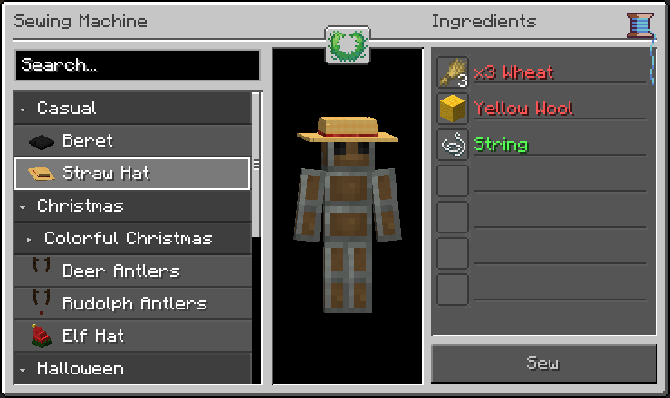
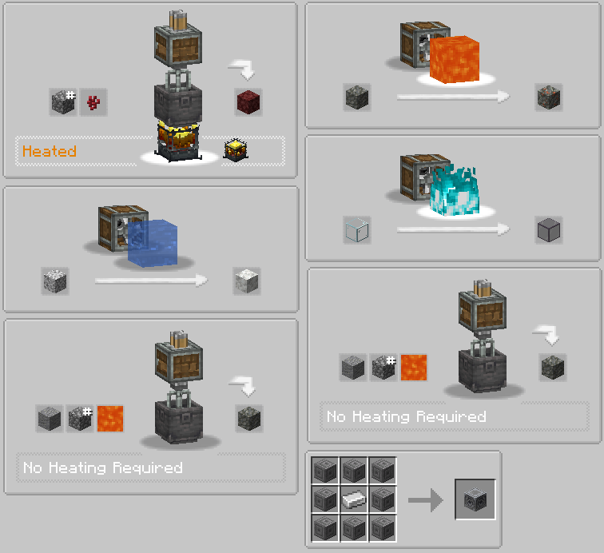

# Create: Forever

**Create: Forever** is Vanilla+ Create and more™ expansion.

## Features

### Sewing & Hats

A dedicated sewing system for crafting wearable cosmetics.

- **Sewing Table** with a custom crafting interface and recipe preview.
- **Custom Sewing Recipes** with their own recipe type.
- **Sewing Spools** used as crafting ingredients.
- **Colorful Hats** including Christmas-themed hats, antlers and elf hats.
- **Custom Advancements** for discovering and crafting hats.
- **JEI Integration** for browsing sewing recipes.

### Playing Cards

Collectible playing cards and card packs.

- A complete deck of **52 unique playing cards** (planed to be revamped soon)

### Decorative & Utility Content

- Colorless concrete and concrete powder variants.
- A bunch of crafting recipes for Create and Steam n Rails.

- This includes automating create rocks, better zinc production, automated blaze cakes and the re-implementation of the old coloring recipes for locometal.

## Installation

1. Download the latest release from [Modrinth](https://modrinth.com/mod/cfcm) or [GitHub Releases](https://github.com/OmegaSleepy/CreateForever/releases).
2. Install the required dependencies.
3. Place the mod JAR into your Minecraft `mods` folder.
4. Launch Minecraft and enjoy!

**Minecraft version:** 1.21.1
**Mod loader:** NeoForge

## Dependencies

- **NeoForge** — Required, 21.1.247+.
- **Create** — Required, 6.0.10+.
- **Create: Steam 'n' Rails** — Optional.
- **Vinery** — Optional.
- **Just Enough Items (JEI)** — Optional, recommended for recipe browsing.

## Roadmap

Create: Forever is actively developed mod, expect bugs. Planned updates include:

- More silly and unusual hats.
- Rare hats, special hat cores and animated cosmetics.
- Additional sewing ingredients and a dedicated tailor villager.
- More playing card sets.
- Card recycling and quality-of-life improvements.
- A dedicated Card Shuffler block.

Features and plans are subject to change.™™™™ (tm)

## Releases

See [GitHub Releases](https://github.com/OmegaSleepy/CreateForever/releases) for release history and downloads.

For development progress, visit the [GitHub repository](https://github.com/OmegaSleepy/CreateForever).

## Contributing & Support

Found a bug, have a suggestion, or want to contribute?

- [Report bugs](https://github.com/OmegaSleepy/CreateForever/issues).
- [Request features](https://github.com/OmegaSleepy/CreateForever/issues). (yeah its the same page)
- [Browse the source code](https://github.com/OmegaSleepy/CreateForever).

Contributions and feedback are always welcome!

## License

This project is licensed under the terms specified in the [LICENSE](LICENSE) file.

---
*Enjoy building forever!*

> Който не играе, не разбира... — Х.К., 2025 г.